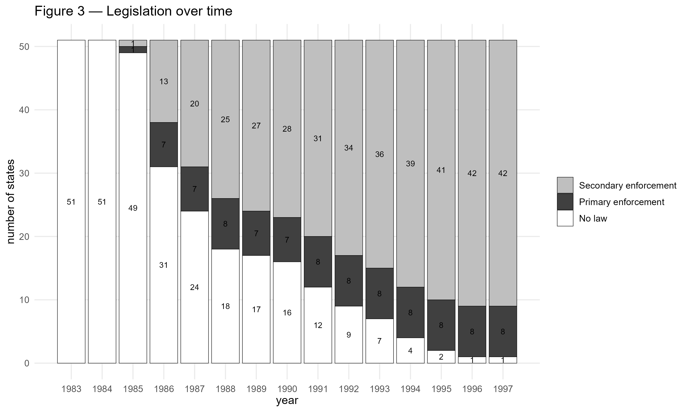

# Les lois sur la ceinture de sécurité réduisent-elles la mortalité routière ?

Évaluation d'une politique publique sur données de panel : réplication en R de l'article d'Alma Cohen et Liran Einav, « The Effects of Mandatory Seat Belt Laws on Driving Behavior and Traffic Fatalities », *The Review of Economics and Statistics*, 2003.

Projet de Master 2 Statistique et économétrie (Université de Strasbourg, janvier 2026), réalisé par **Guillaume Bousson** et **Maé Sénéchal**.

**[Lire le rapport complet (25 pages)](rapport/Rapport_replication_Cohen_Einav_2003.pdf)**

## En bref

- **La politique évaluée.** Entre 1985 et 1997, tous les États américains sauf un ont rendu le port de la ceinture obligatoire.
- **La difficulté.** Les États où la ceinture est très portée ne ressemblent pas aux autres. Les comparer directement donne même un résultat absurde : plus la ceinture est portée, plus la mortalité serait élevée.
- **La méthode.** Des effets fixes par État et par année, puis des variables instrumentales : on ne retient que la hausse du port de la ceinture provoquée par les lois.
- **Le résultat.** Une hausse de 10 % du taux de port réduit d'environ 1,3 % la mortalité des occupants des véhicules. Aucun effet net n'apparaît pour les piétons et les cyclistes.
- **La réplication.** Les coefficients des tables 2 à 5 de l'article sont retrouvés tels qu'ils sont publiés.

## La question

Savoir si ces lois ont sauvé des vies paraît simple. Deux obstacles compliquent pourtant la réponse.

Le premier est un problème de comparaison. Le port de la ceinture n'évolue pas au hasard : il progresse plus vite là où les conducteurs sont plus prudents, où les contrôles sont plus fréquents, où les campagnes de prévention sont plus nombreuses. Tous ces facteurs agissent aussi sur la mortalité, et la plupart ne sont pas mesurés.

Le second tient au comportement des conducteurs. Un conducteur attaché se sent mieux protégé. S'il roule plus vite pour cette raison, la loi peut déplacer le risque vers les piétons et les cyclistes au lieu de le réduire. C'est l'hypothèse du comportement compensatoire.

## Les données

Un panel annuel de 51 juridictions (les 50 États et le district de Columbia) suivies de 1983 à 1997, soit 765 observations. Le taux de port de la ceinture n'est mesuré partout qu'à partir de 1990 : les estimations qui l'utilisent portent sur 556 observations.

Pour chaque État et chaque année, le fichier contient :

- le nombre de tués parmi les occupants des véhicules et parmi les autres usagers (piétons, cyclistes), rapporté aux distances parcourues ;
- le taux de port de la ceinture ;
- le type de loi en vigueur. Avec une loi dite *secondary enforcement*, un agent ne peut sanctionner l'absence de ceinture que s'il a arrêté le véhicule pour une autre infraction. Avec une loi *primary enforcement*, ce seul motif suffit ;
- seize variables de contrôle : revenu, chômage, âge moyen, composition de la population, distances parcourues, densité du trafic, criminalité, taxe sur les carburants, limitations de vitesse, lois sur l'alcool.

Ces données viennent du fichier de réplication mis en ligne par les auteurs. Elles ne sont pas recopiées dans ce dépôt : la marche à suivre pour les télécharger est dans [`data_raw/LISEZ-MOI.md`](data_raw/LISEZ-MOI.md).

## La démarche

L'analyse suit la chaîne causale, maillon par maillon.

| Étape | Question posée | Estimation |
|---|---|---|
| Première étape | Les lois font-elles augmenter le port de la ceinture ? | Taux de port expliqué par les trois indicatrices de loi |
| Forme réduite | Les lois font-elles baisser la mortalité ? | Mortalité expliquée par les trois indicatrices de loi |
| Variables instrumentales | Quel est l'effet du port de la ceinture sur la mortalité ? | Doubles moindres carrés, les lois servant d'instruments au taux de port |

Toutes les régressions comprennent les seize variables de contrôle et des effets fixes par année. Les effets fixes par État sont ajoutés dans un second temps, pour montrer ce qu'ils changent. Les écarts-types sont robustes à l'hétéroscédasticité (HC1), comme dans l'article.

## Les résultats

### 1. Les lois font monter le port de la ceinture

À caractéristiques égales, une loi *secondary enforcement* augmente le taux de port de 11 points et une loi *primary enforcement* de 22 points. Les trois indicatrices de loi sont conjointement très significatives (F = 59,6) : ce ne sont pas des instruments faibles.

### 2. Les lois font baisser la mortalité des occupants

La mortalité des occupants par mile parcouru recule d'environ 4 % avec une loi *secondary enforcement* et d'environ 6 % avec une loi *primary enforcement*. Pour les autres usagers, aucun effet stable ne se dégage.

### 3. Le port de la ceinture réduit la mortalité

Le tableau donne l'élasticité de la mortalité par mile parcouru au taux de port de la ceinture, selon la méthode d'estimation.

| | Comparaison directe | Avec effets fixes par État | Variables instrumentales |
|---|---|---|---|
| Occupants des véhicules | +0,114 (0,029) | −0,053 (0,022) | −0,133 (0,047) |
| Autres usagers | +0,158 (0,056) | −0,119 (0,058) | −0,042 (0,121) |

*Écarts-types robustes entre parenthèses, 556 observations.*

La première colonne illustre le problème de départ. Sans effets fixes par État, plus de ceinture rime avec plus de morts. Ce signe s'inverse dès que l'on compare chaque État à lui-même dans le temps, et l'effet fait plus que doubler quand on isole la variation du port de la ceinture due aux lois. Une hausse de 10 % du taux de port réduit alors la mortalité des occupants d'environ 1,3 %.

Pour les piétons et les cyclistes, l'effet estimé par variables instrumentales n'est pas différent de zéro. Les données ne montrent donc pas de comportement compensatoire.

## Limites

- **L'hypothèse d'exclusion ne se teste pas.** La méthode suppose que les lois n'agissent sur la mortalité qu'à travers le port de la ceinture. Une loi peut pourtant s'accompagner de contrôles plus fréquents ou de campagnes de prévention, qui réduisent eux aussi la mortalité.
- **L'effet mesuré est local.** Il vaut pour les États et les années où le port de la ceinture a réagi aux lois, pas nécessairement ailleurs.
- **Le taux de port manque pour une partie du panel**, surtout avant 1990, et sa mesure varie d'un État à l'autre.
- **Les écarts-types ne sont pas regroupés par État.** Nous avons gardé le choix des auteurs pour rester comparables. Un regroupement par État serait une vérification utile.

Deux éléments de l'article ne sont pas reproduits à l'identique. La seconde série de la figure 2 de l'article (enquête CDC/BRFSS) n'est pas dans le fichier de réplication. La table 1 est reconstruite en années, le fichier ne donnant pas les dates exactes d'adoption des lois.

## Reproduire les résultats

1. Télécharger les données des auteurs en suivant [`data_raw/LISEZ-MOI.md`](data_raw/LISEZ-MOI.md).
2. Ouvrir `evaluation-lois-ceinture.Rproj` dans RStudio.
3. Exécuter `SeatBelts_replication_Cohen_Einav_2003.R`. L'étape 0 lit et prépare les données, les étapes 1 à 6 produisent les figures et les tableaux.

Paquets R utilisés : `dplyr`, `tidyr`, `readr`, `haven`, `stringr`, `janitor`, `ggplot2`, `lmtest`, `sandwich`, `AER`, `stargazer`.

## Contenu du dépôt

Les fichiers de sortie portent les numéros de l'article. Le rapport présente les mêmes résultats dans l'ordre de la chaîne causale, avec sa propre numérotation.

| Dossier | Contenu | Dans l'article | Dans le rapport |
|---|---|---|---|
| `outputs_step1/` | Statistiques descriptives et trois figures | Table A1, figures 1 à 3 | Figures 1 à 3 |
| `outputs_step2/` | Première étape : effet des lois sur le port de la ceinture | Table 4 | Table 1 |
| `outputs_step3/` | Forme réduite : effet des lois sur la mortalité | Table 5 | Table 2 |
| `outputs_step4/` | Effet du port de la ceinture sur la mortalité des autres usagers | Table 3 | Table 3 |
| `outputs_step5/` | Effet du port de la ceinture sur la mortalité des occupants | Table 2 | Table 4 |
| `outputs_step6/` | Résumé des lois État par État | Table 1 | — |
| `rapport/` | Rapport de 25 pages : données, méthode, résultats, limites | | |

## Référence

Cohen, A. et Einav, L. (2003). The Effects of Mandatory Seat Belt Laws on Driving Behavior and Traffic Fatalities. *The Review of Economics and Statistics*, 85(4), 828-843. https://doi.org/10.1162/003465303772815754
